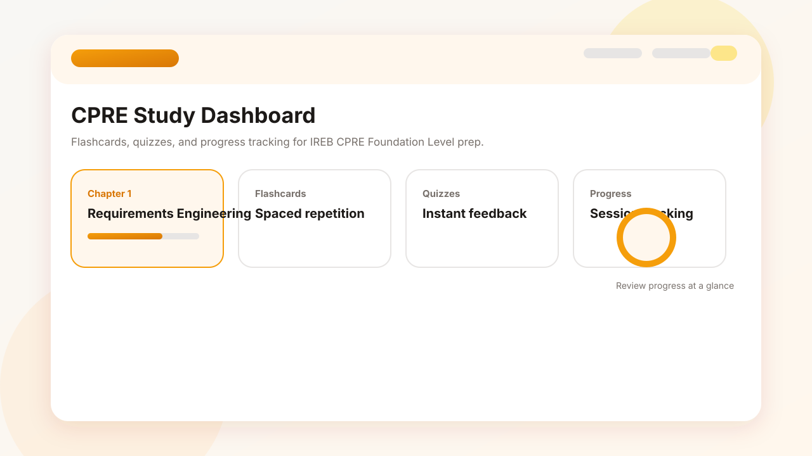
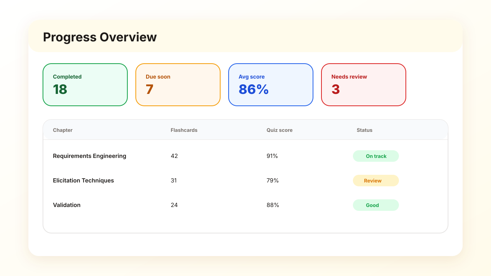

# CPRE Study

CPRE Study is a lightweight self-study app for the IREB CPRE Foundation Level exam. It helps you review requirements engineering concepts with flashcards, chapter quizzes, and progress tracking.

## Preview

## What is included

- Flashcards for core CPRE topics
- Chapter-based quizzes with explanations
- Progress tracking for study history
- A clean browser-friendly interface
- A premium-style alternate layout in `cpre-premium.html`
- A standalone study version in `cpre-study.html`

## Project files

- `index.html` is the app entry point.
- `cpre-study.html` is the standalone study version.
- `cpre-premium.html` is the premium-themed version.
- `cpre_foundationlevel_syllabus_en_v.3.2.pdf` is the reference syllabus.

## How to use

Open `index.html` in a browser, or serve the folder with any static file server. If you want a local server, use VS Code Live Server or `python -m http.server`.

## Local development

There is no build step required for the static HTML version.

1. Open the folder in VS Code.
2. Open `index.html` or `cpre-study.html` in a browser.
3. Study the chapters, answer quizzes, and review your progress.

## GitHub publishing

Suggested repository for publishing:

https://github.com/Pradheepa0810/IREB_CPRE_FL

Suggested git identity:

- GitHub profile: Pradheepa0810
- Email: pradheeparockzz@gmail.com

## Notes

The README uses local SVG images so the documentation stays portable inside the repository.
