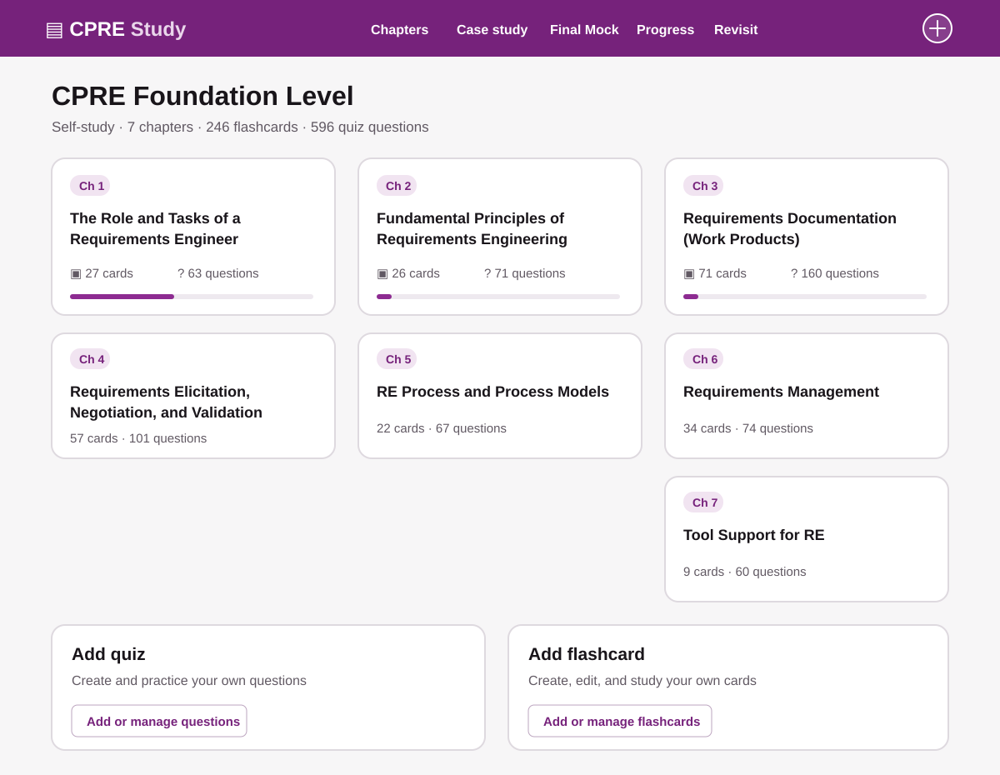
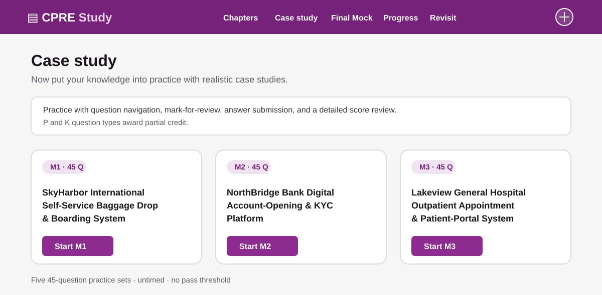
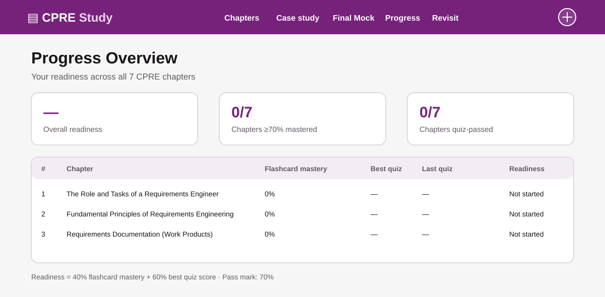

# CPRE Study

CPRE Study is an independent browser-based study aid for IREB CPRE Foundation Level preparation. It includes chapter flashcards and quizzes, case-study practice, timed mock exams, and local progress tracking.

## Preview

These are vector previews of the current interface, not screenshots.

## What is included

- **Chapters:** seven chapters, 596 quiz questions, and 246 flashcards. Add/manage custom quizzes and flashcards below the chapter tiles.
- **Case study:** five practical 45-question sets. These are untimed practice and do not show a pass threshold.
- **Final Mock:** 15 fixed 45-question sets. Tests are timed (75 minutes, or 90 minutes with the non-native-language accommodation) and show a 70% pass threshold.
- **Question formats:** A (single choice), P (select exactly N, partial credit and zero for over-selection), and K (independent true/false statements with partial credit).
- **Progress:** chapter quiz attempts, flashcard schedules, and marked-for-revisit questions are stored in this browser. Custom quiz and flashcard content is stored separately from built-in content. Progress can be exported and merge-imported; there is no shared server database.

## Project files

- `cpre-study.html` is the study app. The small `index.html` redirects the GitHub Pages root to it.
- `assets/cpre-study-data.js` is the app's single runtime JavaScript data bundle; it combines the canonical questions and built-in flashcard deck.
- `assets/quizzes/cpre-fullmock-bank.txt` contains Final Mock tests 1–10 in one text file. Tests 11–15 are in the canonical question bank.
- `assets/quizzes/cpre-question-bank.json` is the editable source for the canonical 140 chapter questions and five 45-question mocks (225 questions).
- `scripts/build-study-data.mjs` validates that JSON and regenerates the runtime bundle. `assets/flashcards/cpre-extra-flashcards.js` supplies built-in flashcards to the bundle builder; the app does not load it separately.
- `assets/quizzes/andrew-quiz-translations.json` and `assets/quizzes/quizlet-question-bank.json` are optional question pools retained for future mock sets. They are not loaded by the current app. The Andrew translations are drafts and need review.
- `assets/quizzes/cpre-quiz-core.js` contains validation and scoring helpers used by the builder and tests. `tests/question-bank.test.mjs` covers the retained data, scoring, and app dependencies.
- `assets/readme/` contains the three local preview illustrations.

| Files | Needed to open the app? | Purpose |
|---|---:|---|
| `assets/cpre-study-data.js` | Yes | Single runtime JavaScript bundle for canonical questions and built-in flashcards. |
| `assets/quizzes/cpre-fullmock-bank.txt` | Yes | Combined text bank for Final Mock tests 1–10. |
| `assets/quizzes/cpre-question-bank.json` | No | Editable source for canonical chapters and case-study mocks; builder input. |
| `scripts/build-study-data.mjs` and `assets/flashcards/cpre-extra-flashcards.js` | No | Validate/build inputs used to regenerate the runtime bundle. |
| `assets/quizzes/andrew-quiz-translations.json` and `assets/quizzes/quizlet-question-bank.json` | No | Optional future question pools; not loaded by the current app. |

## How to use

Open `cpre-study.html` directly in a browser, or open `index.html` to redirect to it. Alternatively, serve the folder with any static file server, such as VS Code Live Server.

## Local development

The browser app is static. To rebuild its data bundle after editing the canonical JSON or flashcards, run `node scripts/build-study-data.mjs`. No build step is needed just to open the app.

1. Open the folder in VS Code.
2. Open `cpre-study.html`.
3. Study chapters, practice with case studies, take a Final Mock, and review progress.

## GitHub Pages

This repository is a static site, so GitHub Pages can serve it directly from the repository root.

1. Push this project to a GitHub repository.
2. In the repository, open `Settings` → `Pages`.
3. Set the source to `Deploy from a branch`, then choose the `main` branch and `/ (root)` folder.
4. Save the settings and wait for the Pages URL to be generated.

The repository root URL redirects to `cpre-study.html`; that page can also be opened directly at `<Pages URL>/cpre-study.html`.

Useful notes:

- Relative asset paths will work on Pages as long as the files remain inside the repository.
- Study progress is stored in each visitor's browser; Pages does not provide cross-device or shared-account synchronization.
- If you later add a build step, update the Pages source to deploy the generated output folder instead.
## Notes

The preview illustrations are local SVG files so the documentation stays portable inside the repository.

## License

The [MIT License](LICENSE) is a permissive software license: for material it covers, it generally allows people to use, copy, modify, redistribute, and sell copies, provided the copyright and permission notice is retained. It also provides the software “as is,” without warranty. Read [LICENSE](LICENSE) for the full terms.

The MIT notice applies only to original software or documentation the named contributor is entitled to license. It does **not** grant rights to third-party material. I do not claim ownership of IREB/CPRE names or marks, syllabus material, imported questions, translations, or other source content; their respective owners retain their rights. This is an independent study aid and is not presented as an official IREB product or endorsement. Check the original sources' terms and obtain any needed permission before redistributing their content. If the named contributor does not hold rights to the original code, the MIT notice should be corrected by the appropriate rights holder.
